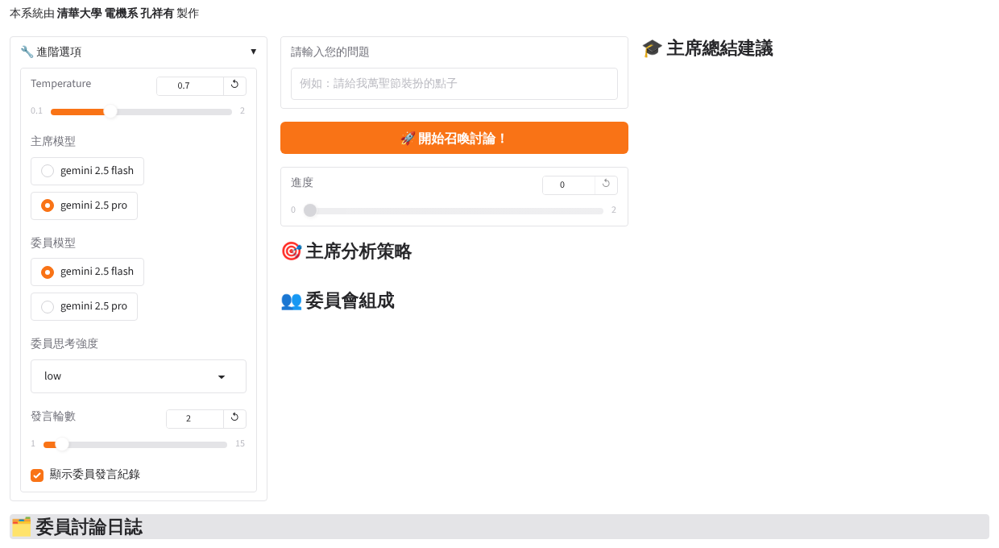
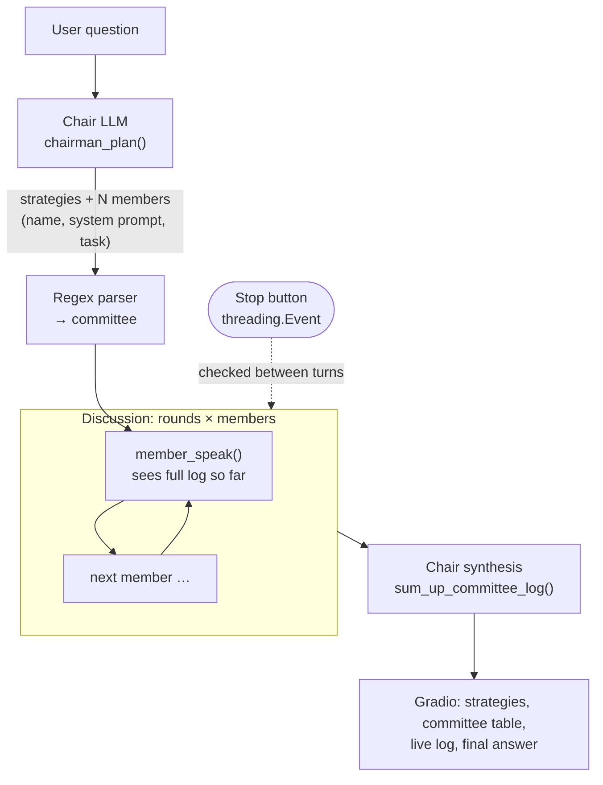

# CommitteeAI — A Chair LLM That Builds Its Own Agent Committee


Ask one question and a **chair** model decides how many agents the problem needs, invents a persona, system prompt and sub-task for each, runs a multi-round discussion among them, and then writes a synthesis. Nobody hand-writes the agent prompts, so the same pipeline handles brainstorming, role-play, debate or plain Q&A.

Individual final project for **Generative AI: Text and Image Synthesis Principles and Practice** (Spring 2025). The UI and prompts are in Traditional Chinese (Taiwan).

<p align="center">
  
</p>

## How it works



1. **Plan.** The chair (Gemini 2.5 Pro by default, high reasoning effort) gets a strict plain-text template: a list of strategies, then one block per member with `name`, `system prompt` and `task`. A regex turns that into the committee.
2. **Discuss.** For each round, every member speaks once. Each call rebuilds the member's view of the meeting: its own earlier turns as `assistant` messages, everyone else's as attributed `user` messages, then a prompt to speak now.
3. **Synthesize.** The chair receives the whole transcript as its system prompt and the original question as the user turn, and is told not to ask follow-up questions (the app is single-turn).
4. **Stream.** `generate_committee_discussion()` is a generator, so Gradio shows the plan, then each new turn, then the summary as they arrive. A stop button sets a `threading.Event` that is checked between turns.

## Engineering decisions

| Problem | What I did |
|---------|-----------|
| **Microsoft AutoGen kept crashing** with `TypeError` because a model returned `None`. After several days I traced it to members with nothing to say, which AutoGen's wrappers gave me no way to handle. | Dropped AutoGen and wrote the discussion loop myself (`member_speak()`), so a `None` reply is logged as *(stayed silent)* instead of killing the run. Earlier AutoGen versions are in the course notebooks, not this repo. |
| Members sometimes declined to speak. | The turn prompt explicitly allows repeating or switching viewpoints and insists on a reply. |
| The chair's output must be machine-parseable. | Its prompt bans Markdown, fixes the section markers and one-line tasks; each rule was added after a parsing failure during testing. |
| Speed vs. quality. | Chair and members can use different models; Flash answers in roughly 15–20 s per call, Pro is slower but plans better. |

## Example run

Question: *"How do you put an elephant in a fridge?"* (2 rounds, Flash for both roles). The chair produced four strategies and this committee (translated from the Chinese output):

| Member | Persona | Task |
|--------|---------|------|
| Puzzle Master 🧠 | Knows riddles and brain-teasers; reveals the hidden simple answer | Recognise the classic riddle and give the standard answer |
| Structural Engineer 🏗️ | Rigorous about physical limits, materials and scale | Explain why it is physically hard and propose a "theoretically possible but extreme" plan |
| Creative Artist 🎨 | Uses metaphor and imagination beyond physical limits | Offer a non-physical, poetic solution |
| Logician 🧐 | Questions premises and definitions | Analyse the key words to find a semantic way out |

The chair's final answer framed the question three ways (riddle, engineering problem, conceptual metaphor) and told the user the right answer depends on which they meant. Full transcript: [`docs/example_run.zh-TW.md`](docs/example_run.zh-TW.md).

**Limitation visible in that run:** members never see the user's question, only the task the chair wrote for them. The first speaker therefore asked "where is the riddle?". A one-line problem statement passed to every member would fix it.

## Run it

**Colab:** open `committee_ai.ipynb`, add your Google AI Studio key under *Secrets* as `GEMINI_API_KEY`, then *Run all*.

**Locally:**

```bash
pip install -r requirements.txt
export GEMINI_API_KEY=your_key
python app.py          # http://127.0.0.1:7860
```

Gemini is called through its OpenAI-compatible endpoint, so the code uses the `openai` client.

## Changes since the course submission

- API key is read from Colab Secrets / an environment variable instead of the notebook.
- Model IDs updated from the 2025 `*-preview-*` names to the stable `gemini-2.5-flash` / `gemini-2.5-pro`.
- Fixed the summary prompt, which unpacked log entries in the wrong order and labelled each turn with the speaker's text instead of the round number.
- Added `app.py`, a script version of the notebook.

## License

MIT. See [LICENSE](LICENSE).
